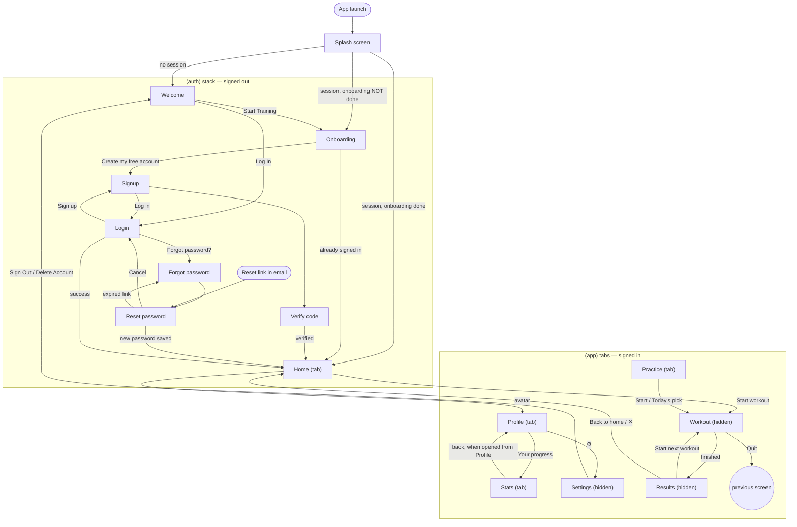
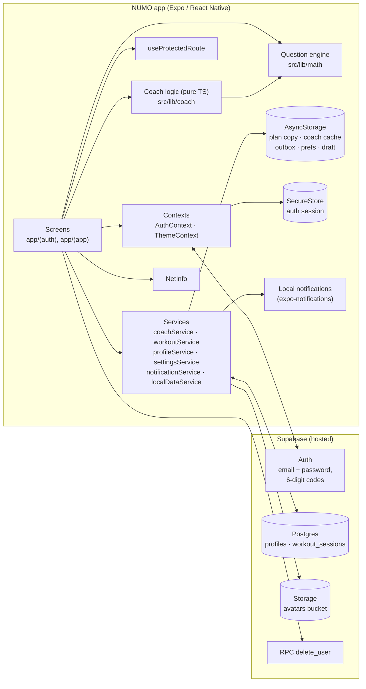

# NUMO — App Overview

*How the app works and what it does, for partners, testers and developers.*

> **Snapshot.** This describes the code in the repository as of 31 October 2026 (branch `main`, last commit `d89af41`, including uncommitted work-in-progress changes to Home, Practice, Results, Statistics and the coach copy). App version in `app.json`: **1.0.0**. Where something could not be confirmed from the code, it is marked **⚠ Unconfirmed** and listed again in [section 10](#10-known-gaps-and-open-questions).

---

## Contents

1. [Summary](#1-summary)
2. [Features](#2-features)
3. [User journey and flows](#3-user-journey-and-flows)
4. [Intake: what the app collects](#4-intake-what-the-app-collects)
5. [Background behavior](#5-background-behavior)
6. [Core logic](#6-core-logic)
7. [Technical architecture](#7-technical-architecture)
8. [Screens reference](#8-screens-reference)
9. [Build and release](#9-build-and-release)
10. [Known gaps and open questions](#10-known-gaps-and-open-questions)

---

## 1. Summary

**NUMO is a mobile app that trains mental math.** It gives people short daily "workouts" of arithmetic questions (adding, subtracting, multiplying, dividing, or a mix) that they answer on an on-screen number pad. It is built for adults and students who feel slow or unsure with everyday numbers: working out a tip, checking a bill, keeping up in class, or doing quick math in an interview or meeting.

**The problem it solves** is that most people never practise mental arithmetic after school, so it gets rusty and stressful. Generic drill apps either feel like a test or give the same questions to everyone. NUMO works more like a personal trainer. On sign-up it asks a few questions (what you want to get better at, which operations feel hardest, how confident you are, and how much time you have). It then builds a plan, starts with a short warm-up, and from then on picks each day's workout for you. It moves each operation up or down between **Easy**, **Medium** and **Hard** depending on how you actually do.

**How it feels to use:** you open the app, see one clear recommendation ("Today: × Multiplying"), press **Start workout**, answer about 10–50 questions (depending on the time you chose), and get a two-page result: your score and speed, then what changed and what's next. A Statistics tab shows your progress in plain sentences ("You're getting faster at ÷ Dividing on Medium"), plus charts, streaks and personal bests. You can set a daily reminder.

**What it isn't (yet):** there are no in-app purchases, subscriptions, ads, social features or analytics tracking in the code. It needs a free account (email and password). Data is stored in a cloud database (Supabase) so it follows you across devices, and the app keeps working, with some limits, when offline.

---

## 2. Features

Each feature is described from the user's point of view, with a short "behind the scenes" note.

### 2.1 Welcome and brand intro
- **What it does:** A first screen with an auto-scrolling carousel of five app screenshots, the line "Train your brain. Master mental math.", a **Start Training** button and a **Log In** link. Privacy Policy and Terms links appear at the bottom.
- **How to get there:** Shown to anyone who is not signed in.
- **Behind the scenes:** The carousel loops endlessly by quietly jumping between three copies of the slide list. The Privacy and Terms links currently point to placeholder URLs (`yourdomain.com`). See [section 10](#10-known-gaps-and-open-questions).

### 2.2 Onboarding ("build your plan")
- **What it does:** Five short steps:
  1. **Goal**: Everyday Quick Math, School & Homework, Sharper Focus & Memory, or Work & Exams.
  2. **What's hardest**: pick any of + Adding, − Subtracting, × Multiplying, ÷ Dividing, Mixing them up, *or* "Not sure, test me".
  3. **Comfort level**: Just starting, Getting there, or Confident.
  4. **How much to train**: 2, 5 or 10 minutes a day (2 is recommended), and 3, 5 or 7 days a week (5 is recommended). It shows the result as "around N questions per workout".
  5. **Plan ready**: a summary card, then **Create my free account**.
- **How to get there:** **Start Training** on Welcome. Onboarding happens *before* the account is created.
- **Behind the scenes:** The answers are saved on the phone as a "draft". After the account is created and the email is verified, the app copies the draft to the user's cloud profile automatically. The time choice decides the daily question count: 2 min gives 10 questions, 5 min gives 20, and 10 min gives 50. Onboarding needs an internet connection at the last step; offline, it shows "You're offline. Connect to the internet to save your plan."

### 2.3 Account: sign up, verify, log in, reset password
- **What it does:** Sign up with full name, email and password (at least 6 characters, with a strength meter). A 6-digit code is emailed and entered on a verification screen, with resend available after 60 seconds. Users can log in with email and password, or reset a forgotten password. The reset email contains a 6-digit code and/or a link, depending on the Supabase email template.
  - **The reset flow:** the code, or tapping the link (which opens the app at `numo://reset-password`), leads to a **Set a new password** screen. The user stays there until the new password is saved; they can't reach Home before that, even if they close and reopen the app. After saving, they're in the app, signed in, and their other devices are signed out. **Cancel and sign out** leaves without a new password.
  - **Expired or used links:** the user is told so and offered a new one.
- **How to get there:** From Welcome (**Log In**), from the end of onboarding, or **Forgot password?** on Log In.
- **Behind the scenes:** Supabase Auth (a hosted login service) sends the emails and checks the codes and links. Reset links are read by [src/hooks/useRecoveryLinks.ts](../src/hooks/useRecoveryLinks.ts). While a reset is in progress, a "recovery" flag in [src/context/AuthContext.tsx](../src/context/AuthContext.tsx) makes the route guard keep the user on the reset screen. The login session is stored in the phone's secure, encrypted storage (on the web build, in the browser's local storage), so users stay signed in between launches.

### 2.4 Home: today's recommendation
- **What it does:** Shows a goal line (for example "Great for quick shopping math."), a heading and short description from the coach (for example "Today: ÷ Dividing — You picked this one. 10 questions, about 2 minutes."), and five round "bubbles" for the operations. The recommended one is large in the centre. Tapping another bubble makes a one-time choice ("Your pick: + Adding — Just this once, then back to your plan."). Tapping the centre goes back to the recommendation. A big **Start workout** button starts the round. Once a week a small "Try something new: × Multiplying" link may appear. The avatar in the top corner opens Profile.
- **How to get there:** The **Home** tab, the first screen after sign-in.
- **Behind the scenes:** Each time Home is shown, it loads the plan and workout history (from the cloud, or from the phone's saved copy when offline) and runs the coach logic (see [6.3](#63-the-coach-what-to-practise-today)). It also retries uploading any workouts that were saved offline.

### 2.5 Workout (answering questions)
- **What it does:** One question at a time in large type (for example `28 ÷ 4`). The user types on a custom number pad and submits. A correct answer briefly pulses green; a wrong one shakes red. After about half a second the next question appears. A progress bar and counter ("3/10") are at the top, with a title such as "Warm-up · 10 questions" or "× Multiplying · Medium". The ✕ button asks "Quit Workout? Your progress for this workout will not be saved."
- **How to get there:** **Start workout** on Home, **Start** on Practice, the Today's pick card, or **Start next workout** on Results.
- **Behind the scenes:** Questions are generated on the phone (no server is involved). The time taken on each question is measured. At the end the round is saved to the cloud. If that fails, it is stored on the phone and uploaded later (see [5.2](#52-offline-outbox-and-sync)). Answers can be at most 6 digits. There is no countdown timer: speed is measured, never enforced.

### 2.6 Results (two steps)
- **What it does:**
  - **Step 1, "Your result":** the score counts up to "8/10", then accuracy and speed ("80% accuracy · 2.4 seconds per question"), a short verdict (for example "Quick and mostly right") and a comparison with the last similar round ("↑ 2 more correct than last time"). A perfect round gets a "Perfect round · 100% correct" card. Otherwise there is a **Review N questions** button that lists each missed question, what the user typed and the correct answer. If the save failed, a note says "Saved on this device. It will sync when you're back online." with a **Retry** button.
  - **Step 2, "What's next":** celebrations (level up, mastered an operation, daily goal reached, with confetti for the big ones), calm coach lines ("Let's practice × on Easy for a bit."), at most one Yes / Not now question, and a "Next up" card with **Start next workout** (or **Bonus round** once the daily goal is done) and **Back to home** (or **Done for today**).
- **How to get there:** Automatically at the end of every workout.
- **Behind the scenes:** The coach compares the history before and after this round to find level changes, mastery, and which question (if any) to ask. Yes / Not now answers update the plan in the cloud or are remembered on the phone for 7 days. Vibration feedback (haptics) plays on celebrations and button presses.

### 2.7 Practice: pick any operation and level
- **What it does:** Shows the "Today's pick" card (the same recommendation as Home) and an "All operations" list. Each row shows the operation's current coach level and a "Mastered" tag where earned. Tapping a row opens a sheet to choose Easy / Medium / Hard, each with an example such as "like 4×7". For a mix there is also **Your levels (recommended)**. Choosing a level other than the user's own marks it as a **practice round** that won't change their level.
- **How to get there:** The **Practice** tab.
- **Behind the scenes:** Before the first workout, only the warm-up level is offered ("Warm-up first. After your warm-up, you can pick any level."). Practice rounds are saved with `source = manual`, and the coach ignores them when deciding levels.

### 2.8 Statistics: "Your progress"
- **What it does:**
  - A one-sentence progress headline (for example "You moved up to Hard on + Adding!" or "You're getting faster at × Multiplying on Medium."), with a supporting line.
  - **Week / Month / Year** tabs and filter chips (All, + Adding · Medium, …).
  - Totals for the range: questions, accuracy and time spent.
  - A bar chart of questions per day, week or month, with the current period highlighted. Below it, a per-operation breakdown, or for a single operation, "2 more strong rounds to reach Hard".
  - A streak card: days in a row, "3 of 5 days this week", and dots for Mon–Sun.
  - Personal bests: longest streak, best day ("Best day: 120 questions, October 12"), lifetime questions and mixed rounds played.
  - Pull down to refresh.
- **How to get there:** The **Stats** tab, or **Your progress** on Profile (which adds a back button to Profile).
- **Behind the scenes:** Everything is calculated on the phone from the workout history. Progress is only ever compared within one operation at one level, so moving up to harder questions never looks like getting worse. The app never reports that someone got slower or less accurate.

### 2.9 Profile
- **What it does:** Shows the profile photo, name and email, a **Rank** (Beginner → Quick Thinker at 150 lifetime questions → Number Ninja at 500 → Math Master at 1,000) with a progress bar, and a **Your progress** link to Statistics. It also has:
  - **Your plan**: Focus (goal), Working on (weak spots), Level (comfort).
  - **Training goals**: Time per day, with "N of M questions today", and Days per week, with "N of M days this week".

  Each item opens a sheet to change it. Changing **Level** warns: "This will set all your operations to Medium. Continue?"
- **How to get there:** The **Profile** tab, or the avatar on Home. The gear icon opens Settings.
- **Behind the scenes:** The user can tap the photo to take a picture or choose one from the library (this asks for camera or photo permission). The photo is uploaded to cloud storage and shown through its public link. Each upload is saved as a new file, and once it's saved the user's older photo files are deleted. "Remove Photo" deletes the files too. Name changes are saved to the profile and to the login account. Plan changes are saved to the cloud first. If that fails, the screen puts the old value back and shows "Couldn't save your changes. Please try again." Profile needs a connection the first time it loads.

### 2.10 Settings
- **What it does:** Dark mode switch, a **Haptic Feedback** switch (turns off every vibration in the app), a **Daily Push Notifications** switch with a reminder time picker (7:00 AM … 9:00 PM), links to the help centre, feedback email, privacy policy and terms, **Change Password** (requires the current password), **Sign Out**, and **Delete Account**. At the bottom:
  - A **workout sync status**: "All workouts synced", "2 workouts waiting to sync · Sync now", or "Offline · …". The count is the phone's queue of workouts that failed to save.
  - The **version**: "NUMO v1.0.0 (build)". The version is read from `app.json`; the build number comes from the installed app (it is left out in Expo Go and on the web).
- **How to get there:** The gear icon on Profile.
- **Behind the scenes:**
  - The reminder is a *local* notification scheduled on the phone (no server sends it).
  - Sign Out first tries to upload unsynced workouts. If some are still waiting, it asks "Sign Out Anyway?". It then clears this person's data from the phone.
  - Delete Account asks for confirmation, deletes the user's profile photo files, then calls the `delete_user` server function. That function removes the login account, and the profile and workout history go with it automatically. The app then signs out, discards any unsynced workouts and returns to Welcome. If the photo cleanup fails, the account is still deleted and the error is logged.
  - All vibrations go through one helper ([src/utils/haptics.ts](../src/utils/haptics.ts)) that checks the Haptics setting. The app has no sounds, so there is no sound switch.
  - The sync status refreshes when Settings opens. When the connection comes back, Settings retries the queue straight away.

### 2.11 Offline support
- **What it does:**
  - Home, Practice and Statistics keep working offline using the last copy saved on the phone, with a small note ("You're offline. Workouts still save and sync later.").
  - If nothing was ever saved on this phone, Home says "Pick something to practice", and rounds won't change levels.
  - Results offers "the same round again".
  - **Workouts run fully offline.** The workout screen shows a small "Offline · your result will sync later" line, and the result is saved on the phone. Results says "Saved on this device. It will sync when you're back online." Home, Practice and Stats then show "1 workout is waiting to sync." until it has uploaded.
  - Users stay signed in offline, even after their login token has expired.
  - Profile shows an "App can't connect" screen until it has loaded once.
- **Behind the scenes:** See [5.2](#52-offline-outbox-and-sync).

### 2.12 Appearance and accessibility
- Light and dark themes follow the phone's setting until the user flips the switch in Settings.
- Layouts cap their width on tablets, honour the "Reduce Motion" setting for celebrations, and include screen-reader labels throughout.

---

## 3. User journey and flows

### 3.1 First launch and onboarding
1. **App opens.** A splash screen ("N / NUMO") shows for at least 1.8 seconds (at most about 4.5 seconds) while fonts load and the app checks whether someone is signed in.
2. **Not signed in → Welcome.** The user taps **Start Training**.
3. **Onboarding, steps 1–5.** The user answers the questions. On the last step, **Create my free account** saves the answers on the phone and marks onboarding as done on this device.
4. **Sign up.** The user enters name, email and password, then taps **Create Account**. If the email already exists: "An account with this email already exists. Please log in."
5. **Verify email.** The user enters the 6-digit code, sees "Verified! Your account has been confirmed.", and taps **Continue**.
6. **Draft applied.** As soon as there is a signed-in session, the app copies the onboarding answers to the cloud profile, marks `has_completed_onboarding = true`, and opens **Home**.
7. **First workout = the warm-up.** Home says "Let's start with a warm-up" (or "Let's see what you're great at" for "Not sure" users). It is 10 questions on the chosen operations.
8. **First Results.** Results says something like "Nice start! ÷ Dividing was the trickiest. We'll practice that next." "Not sure" users are asked "Want to focus on ÷ Dividing?"

**Returning user on a new device:** Welcome → **Log In** → the app sees the profile already has onboarding complete → Home.

**Signed in but onboarding not complete** (for example, an account created another way): the user is sent to Onboarding. Finishing it while signed in saves straight to the cloud and goes to Home.

### 3.2 Daily use
1. Open the app → Home shows today's recommendation.
2. Optionally tap a different bubble for a one-off choice.
3. **Start workout** → answer the questions → Results step 1 → **Continue** → step 2.
4. Answer any Yes / Not now question, then **Start next workout** (or a bonus round) or **Back to home**.
5. Once the daily question goal is reached, Home shows "Goal done for today! Come back tomorrow, or do a bonus round."

### 3.3 Secondary flows
- **Choose a specific level:** Practice tab → tap an operation → pick a level → **Start**.
- **Check progress:** Stats tab (or Profile → Your progress) → switch Week / Month / Year → filter by operation.
- **Change plan or goals:** Profile → tap a card → pick a new value. Changing Level resets every operation's coach level to the new starting level.
- **Profile photo and name:** Profile → tap the photo or name.
- **Reminders:** Profile → ⚙ Settings → Daily Push Notifications on → allow notifications → pick a time.
- **Change password:** Settings → Change Password → current, new and confirm.
- **Forgot password:** Log In → Forgot password? → email → 6-digit code (or tap the link in the email) → Set a new password → Home, signed in.
- **Sign out:** Settings → Sign Out → (sync check) → Welcome.
- **Delete account:** Settings → Delete Account → Permanently Delete → Welcome.
- **Purchases:** none. The app has no in-app purchases or subscriptions.

### 3.4 Screen navigation (flowchart)



---

## 4. Intake: what the app collects

**In plain English:** NUMO collects your name, email and password to make an account; your answers from onboarding to build your plan; and the results of every workout you do (scores, times, which operations, at what level). Optionally it stores a profile photo and a reminder time. It does not collect location, contacts, advertising IDs or analytics. Most data lives in the app's cloud database (Supabase). Some is also kept on the phone for speed and offline use. When you sign out, the personal data on the phone is cleared.

"On device" below means **AsyncStorage** (the phone's ordinary key-value app storage) unless it says **SecureStore** (the phone's encrypted keychain or keystore).

### 4.1 Account and identity

| Data | Why | Where stored | How long kept |
|---|---|---|---|
| Email | Login, verification and reset codes | Supabase Auth (remote) | Until the account is deleted |
| Password | Login | Supabase Auth (remote, handled by Supabase; the app never stores it) | Until changed or the account is deleted |
| Full name | Greeting, avatar initials | Supabase Auth user metadata and `profiles.full_name` (remote) | Until changed or the account is deleted |
| Login session (access and refresh tokens) | Stay signed in | **SecureStore** on iOS/Android; browser `localStorage` on web | Until sign-out or expiry (auto-refreshed) |
| Profile photo | Avatar | Supabase Storage bucket `avatars` at `<userId>/avatar_<timestamp>.<ext>`. The bucket is public: anyone with a photo's URL can open it. Only the owner can list or read their files through the API. The URL is saved in `profiles.avatar_url` and auth metadata | Until replaced: older files are deleted after a new upload. "Remove Photo" and account deletion delete all of the user's files |

### 4.2 Plan (onboarding answers and Profile choices)

| Data | Why | Where stored | How long kept |
|---|---|---|---|
| Primary goal (`everyday` / `school` / `memory` / `work`) | Goal line on Home | `profiles.goals` (array, first item used); phone copy in `@numo_user_training_goals` | Remote: until changed or deleted. Phone: cleared at sign-out |
| Weak spots (`friction_areas`, plus legacy `friction_area`) | The coach's daily picks; an empty list means "Not sure, test me" | Same | Same |
| Comfort level (`starting` / `getting_there` / `confident`) | Starting difficulty | `profiles.comfort_level`, plus `profiles.level_set_at` (when it last changed) | Same |
| Time per day (minutes) → daily question goal | Round length and daily goal | `profiles.session_duration_minutes`, `profiles.daily_question_goal` | Same |
| Days per week | Weekly target in Stats and Profile | `profiles.weekly_frequency_days` | Same |
| Onboarding completed flag | Routing | `profiles.has_completed_onboarding`; phone flag `@numo_onboarding_completed` | Phone flag cleared at sign-out |
| Onboarding draft (all of the above, before sign-up) | Survive the gap between onboarding and verifying the email | Phone only, `@numo_onboarding_draft` | Deleted once applied to the cloud, or at sign-out |

### 4.3 Workout data

| Data | Why | Where stored | How long kept |
|---|---|---|---|
| Each finished workout: operation, difficulty, total, correct, incorrect, accuracy %, total time (ms), average time per question, `source` (`warmup` / `coach` / `manual`), `breakdown` (per-operation questions, correct, time and level), `completed_at` | Levels, progress, stats, streaks | Supabase table `workout_sessions` (remote) | Until the account is deleted (removed with it, by `ON DELETE CASCADE`) |
| Individual questions and answers | Shown once on Results ("Review N questions") | Passed between screens only; **not saved** to the cloud. Kept on the phone only while a workout waits in the offline queue | Discarded after Results, or after the upload |
| Unsynced workouts (offline queue) | Upload later | Phone, `@numo_workout_outbox_v1:<userId>` | Until uploaded. Kept through sign-out (unless the account is deleted) so they upload when that person signs in again |
| Cached plan, last 300 workouts and lifetime totals | Offline Home, Practice and Stats | Phone, `numo_coach_cache_v1:<userId>` | Overwritten on each online load; cleared at sign-out |
| "Not now" times for the level and graduation prompts | Don't ask again for 7 days | Phone, `numo_level_prompt_dismissed_v1:<userId>`, `numo_graduation_prompt_dismissed_v1:<userId>` | Cleared at sign-out |

### 4.4 Device preferences (not personal; kept after sign-out)

| Data | Where | Notes |
|---|---|---|
| Theme (`system` / `light` / `dark`) | `user_theme` | |
| Haptics on/off | `@numo_haptics_enabled` | Read by every vibration in the app (via `src/utils/haptics.ts`). Older versions also saved `@numo_sound_enabled`; it is no longer used |
| Reminders on/off, reminder time | `@numo_reminders_enabled`, `@numo_reminder_time` | Treated as personal: cleared at sign-out, and the scheduled reminder is cancelled |

### 4.5 Permissions requested

| Permission | When | Why |
|---|---|---|
| Notifications | When the reminder switch is turned on | Daily local reminder. On Android, also creates a "Daily Training Reminders" channel |
| Camera | Profile → photo → Take Photo | Profile picture |
| Photo library | Profile → photo → Choose from Library | Profile picture |

No location, contacts, microphone, tracking (ATT) or background-refresh permissions are requested.

### 4.6 Device information read
- **Network state** (connected or reachable), via NetInfo, to decide between live and offline data.
- **Whether it's a real device or a simulator**, via `expo-device`, only to skip the notification permission prompt on simulators.
- **Screen size, safe-area insets, light/dark preference and Reduce Motion**, for layout and animations.
- **The local clock and time zone**: all "today", "this week" and streak calculations use the phone's local calendar day.

Nothing about the device is sent to the server except what Supabase's own client sends by default ⚠ (request headers; not inspected here).

---

## 5. Background behavior

**In plain English:** Without the user doing anything, the app keeps them signed in, quietly re-uploads workouts that failed to save, keeps a copy of their progress on the phone for offline use, reloads screens when the connection comes back, updates "today" at midnight, and, if they turned it on, shows one reminder notification a day. It does not track users or send analytics, and it has no other third-party services besides Supabase.

### 5.1 Session handling
- At launch, `AuthProvider` ([src/context/AuthContext.tsx](../src/context/AuthContext.tsx)) reads the saved session. It then listens for sign-in and sign-out events from Supabase.
- Supabase refreshes the login token automatically (`autoRefreshToken: true` in [src/config/supabase.ts](../src/config/supabase.ts)).
- When a session ends for *any* reason (sign-out or expiry), the previous user's personal data is wiped from the phone ([src/services/localDataService.ts](../src/services/localDataService.ts) `clearLocalUserData`).
- Route protection ([src/hooks/useProtectedRoute.ts](../src/hooks/useProtectedRoute.ts)) re-checks on every navigation. It sends signed-out users to Welcome and signed-in users without onboarding to Onboarding, and keeps signed-in users out of the auth screens. On the first check after sign-in, it also applies any leftover onboarding draft to the cloud profile.

### 5.2 Offline outbox and sync
- When a workout finishes, `saveOrQueueWorkout` ([src/services/workoutService.ts](../src/services/workoutService.ts)) decides what happens:
  - **offline:** the round goes straight onto a per-user queue on the phone;
  - **online:** it is saved to `workout_sessions`. If the save fails or takes longer than **8 seconds**, the round is queued instead.
- The queue is retried (`flushWorkoutOutbox`):
  - whenever the connection comes back, and whenever the app returns to the foreground, on any screen (`useWorkoutAutoSync` in the signed-in layout);
  - on app launch, if signed in, and on every sign-in;
  - every time Home, Practice, Stats or Results load coach data;
  - on the Results **Retry** button and Settings **Sync now**;
  - before sign-out.
- **No duplicates.** Before uploading a queued workout, the app checks whether the server already has a workout from this user with the same finish time. That covers a save that arrived even though the phone gave up waiting. Calls made while an upload is running wait for it instead of starting a second one.
- Uploads go in order and stop at the first failure. The original finish time is preserved.
- Screens show queued workouts as if they were already saved, so the coach and stats stay correct offline. A queued workout that already reached the server counts once.
- **Signed in offline:** if the login token has expired while offline, Supabase can't refresh it and reports no session. The app then uses the session saved on the phone ([src/context/AuthContext.tsx](../src/context/AuthContext.tsx)), and the next request online refreshes it. The route guard doesn't send a returning user to onboarding just because their profile can't be read offline.

### 5.3 Cached progress
- After every successful online load, the plan, the newest 300 workouts and the lifetime records are saved on the phone ([src/services/coachService.ts](../src/services/coachService.ts) `saveCoachCache`). A load that finishes after sign-out never writes data back.
- Loading order (`loadCoachDataWithFallback`):
  1. live from Supabase (waiting at most **10 seconds**);
  2. otherwise the cached copy plus queued workouts;
  3. otherwise the plan saved on the phone plus queued workouts. This last case is called "history unknown": no recommendation, and every round counts as practice.

### 5.4 Reconnection and day changes
- `useOnlineStatus` ([src/hooks/useOnlineStatus.ts](../src/hooks/useOnlineStatus.ts)) watches the network. Home, Practice, Stats and Profile reload automatically when the connection returns.
- `useToday` ([src/hooks/useToday.ts](../src/hooks/useToday.ts)) moves Stats to the new day at midnight, or when the app returns to the foreground on a new day.
- Home, Practice, Stats and Profile reload every time they come into view.

### 5.5 Notifications
- **Local only**: no push server and no push token. `scheduleDailyReminder` ([src/services/notificationService.ts](../src/services/notificationService.ts)) cancels all scheduled notifications, then schedules one repeating daily notification at the chosen hour and minute: *"Time for your daily drill — Keep your momentum going. Complete a quick 10-question workout today!"*. The body always says 10 questions, whatever the user's goal.
- Notifications also show while the app is open (banner and sound).
- They are cancelled on sign-out (and turning the switch off cancels them too).

### 5.6 Developer-only startup check
- In development builds only, `runMathEngineTests` ([src/lib/math/generatorTest.ts](../src/lib/math/generatorTest.ts)) runs a few sanity checks on the question generator at launch and logs the results to the console.

### 5.7 Not present
- No analytics or tracking SDKs, crash reporting, ads, in-app purchases, remote config, background fetch or background tasks were found in the code or dependencies.

### 5.8 Third-party services
- **Supabase** (hosted backend), used for authentication (email/password, 6-digit email codes), the Postgres database (`profiles`, `workout_sessions`), file storage (`avatars` bucket), and one server function (`delete_user`). Its address and public key come from environment variables (see [7.7](#77-environment-and-config)).
- **Expo / EAS** for building and shipping, not at runtime. The project ID is in `app.json`.
- Outbound links (opened in the browser or mail app): `numo.app/help`, `numo.app/privacy`, `numo.app/terms`, `mailto:support@numo.app`, and placeholder `yourdomain.com` links on Welcome.

---

## 6. Core logic

**In plain English:** Questions are made up randomly on the phone from fixed number ranges for Easy, Medium and Hard. Each of the four operations has its own level. It goes **up** after three strong rounds in a row (85% or more correct) and **down** after three weak rounds in a row (under 60%). An operation is **mastered** after five strong rounds on Hard spread over at least two days. Each day the coach picks the operation you're weakest at from the ones you said were hard, with a "mix" round every fourth time. Streaks count calendar days with at least one workout. Practice rounds you start at a level other than your own never change your levels.

All of this logic is plain TypeScript with no screen code. It lives in [src/lib/math/](../src/lib/math/) and [src/lib/coach/](../src/lib/coach/), and is covered by the unit tests in `__tests__` folders next to it.

### 6.1 Question generation

[src/lib/math/questionGenerator.ts](../src/lib/math/questionGenerator.ts): `QuestionGenerator.generateSession`, `generateNumbers`, `pickMultiplicationFact`, `planOperationOrder`.

| | Easy | Medium | Hard |
|---|---|---|---|
| **+** | 2–20 + 1–9 | 10–99 + 10–99 | 100–500 + 10–99 |
| **−** | 2–20 − 1–9 (smaller second number) | 20–99 − 2…(first−1) | 100–500 − 10–99 |
| **×** | tables 2, 3, 4, 5, 10 × 2–10 | 2–9 × 2–9 | 50%: 11 or 12 × {6,7,8,9,11,12}; 50%: 3–9 × a two-digit number 11–29 not ending in 0 |
| **÷** | Mirrors × at the same level: the product divided by one factor (always a whole number, never ÷1) | | |

- Subtraction answers are always positive. ×1 and ÷1 never appear.
- **No repeats in a round**: up to 25 retries to avoid a question already asked. "3 × 4" and "4 × 3" count as the same question.
- **Mixed rounds** spread questions evenly across the operations (20 questions over 4 operations gives 5 each), then shuffle the order. Each operation can have its own level within one round (`difficultyByOperation`).
- **Answer checking** ([src/lib/math/questionValidator.ts](../src/lib/math/questionValidator.ts) `validateAnswer`, `recordAttempt`): whole-number exact match. Time per question is measured from when it appears to when the answer is submitted.

### 6.2 Levels (difficulty per operation)

[src/lib/coach/difficulty.ts](../src/lib/coach/difficulty.ts): `getLevelState`, constants `STRONG_ACCURACY = 85`, `WEAK_ACCURACY = 60`, `STREAK_TO_MOVE = 3`, `MIN_QUESTIONS_TO_COUNT = 5`.

- **Start level** comes from the comfort level: Just starting → Easy, Getting there → Medium, Confident → Hard (`comfortToDifficulty` in [src/types/profile.ts](../src/types/profile.ts)). Older accounts without a comfort level start from the level of their most recent older workout.
- The app **replays the history from oldest to newest**, for each operation separately:
  - It only counts rounds **at the current level**, **not manual**, and **after `level_set_at`** (changing Level in Profile restarts everything).
  - A round counts if it has **5 or more questions** on that operation. Mixed rounds usually have fewer per operation, so those questions are **pooled across mixes** until there are 5 or more, then judged as one round.
  - 85% or more = strong; under 60% = weak; anything between resets both counts.
  - **3 strong in a row → up one level; 3 weak in a row → down one level.** It moves one step at a time, never past Easy or Hard.
- Results shows level changes by comparing the levels before and after this workout (`diffLevels`).

### 6.3 The coach: what to practise today

[src/lib/coach/coach.ts](../src/lib/coach/coach.ts): `getCoachPlan`, `workoutForOperation`; [src/lib/coach/stats.ts](../src/lib/coach/stats.ts): `pickWeakest`, `getOperationStats`.

The coach checks these cases in order:

1. **History unknown** (offline and nothing cached): there is no pick. It offers a mixed round at the starting levels, saved as **manual**.
2. **First workout = warm-up**: until a non-manual workout exists, the recommendation is a **10-question warm-up** over the chosen operations (all four if "Not sure" or only "Mixing them up" was chosen).
3. **After the warm-up:**
   - **Candidates** are the chosen operations that are not yet mastered (if all are mastered, all chosen ones), plus "mixed" if the user picked "Mixing them up".
   - **Every 4th coach workout is "Mix it up"** (`MIX_EVERY = 4`): all four operations, each at its own level.
   - **Quick check:** a mastered operation with no counted round in **14 days** gets a check-up round.
   - Otherwise **pick the weakest** (`pickWeakest`):
     1. an operation with no recent data, in plan order;
     2. otherwise the lowest accuracy over its last 10 rounds;
     3. if several are within 5 points of each other, the least recently practised, then the one getting slower.
   - **Round length** = the daily question goal (default 10).
   - **Message** priority: "Goal done for today!" → "Mix it up" → "Quick check" → "You're getting faster!" (last 3 rounds at least 10% faster with accuracy holding) → "Today: …".
   - **Try something new**: on every 7th day after the first workout, suggests an operation the user did *not* pick and hasn't practised alone in a week.
- **Choosing a different bubble or level** (`workoutForOperation`): the coach's level for that operation is used unless a different level is chosen. A different level makes it **manual**, so it never moves levels.

### 6.4 Mastery and "graduation"

[src/lib/coach/mastery.ts](../src/lib/coach/mastery.ts): `isMastered`, `levelProgress`, `suggestNextOperation`, `addToPlan`; `MASTERY_ROUNDS = 5`, `MASTERY_MIN_DAYS = 2`.

- **Mastered** means the operation is on Hard, and its **last 5 counted rounds on Hard were all strong**, played on **at least 2 different days**.
- Mastered operations drop out of daily picks while others remain, but still appear in mixes and quick checks.
- **Graduation:** when an operation in the plan is mastered, Results asks "Want to add × Multiplying to your plan?". It suggests the weakest operation that is not yet in the plan, or + → − → × → ÷ if there is no data. **Not now** waits 7 days.
- Statistics shows what's left: "2 more strong rounds to reach Hard", "3 more strong rounds on Hard to master it", or "1 more strong round on another day to master it".

### 6.5 Results feedback

[src/lib/coach/results.ts](../src/lib/coach/results.ts) `getResultsFeedback`; [src/lib/coach/roundSummary.ts](../src/lib/coach/roundSummary.ts).

- **Warm-up insight:** the trickiest operation (lowest accuracy, then slowest), for example "Nice start! ÷ Dividing was the trickiest. We'll practice that next."
- **At most one question per Results screen**, in this priority:
  1. **Graduation** (above).
  2. **Focus question**, only for "Not sure" users, after the first workout and then every 5th workout: "Want to focus on ÷ Dividing?". Yes makes it their only weak spot.
  3. **Level suggestion**: when every chosen operation has been on Hard for its last 3 counted rounds and the comfort level isn't Confident: "Want to change your level to Confident?". Yes resets levels from Hard. Not now waits 7 days.
- **Celebrations:** mastered everything (once), newly mastered, daily goal just reached (only on the workout that crossed it), level up. Level downs are shown as calm text lines.
- **Comparison with the last similar round** (`compareWithLast`): same operation(s) at the same level(s). Score comes first; speed only breaks a tie (at least 5% faster per question counts as "Faster than last time").
- **Verdict** (`getVerdict`): based on accuracy and the user's own usual pace at that level (needs 2 or more earlier rounds). Examples: "Fast and correct" (90% or more and within 5% of usual pace), "Right answers, steady pace", "Fast, but check your answers" (under 75% and at least 10% faster than usual). Without a usual pace it judges accuracy only.

### 6.6 Statistics, streaks and records

[src/lib/coach/progress.ts](../src/lib/coach/progress.ts), [src/lib/coach/activity.ts](../src/lib/coach/activity.ts), [src/utils/localDates.ts](../src/utils/localDates.ts).

- **Progress headline** (`progressHighlight`), in order:
  1. a level-up in the last 14 days;
  2. else the biggest same-level gain, comparing the last 5 counted rounds with the 5 before ("faster" = 10% less time with accuracy holding; "more accurate" = 5 or more points better);
  3. else "steady" on the most recent operation;
  4. else "Do a few more workouts…".

  It never reports a decline.
- **Activity chart** (`getActivity`): every question counts once. Mixed rounds are split into their operations; older mixes saved without a breakdown count only under "All" ("Older mixes"). Ranges:
  - Week: Monday to Sunday.
  - Month: Monday-first weeks, cut at the month's edges.
  - Year: by month.
- **Streak** (`countDayStreak`): consecutive local days with at least one workout, ending today or yesterday. **Longest streak** and **best day** (most questions in one local day; on a tie, the earlier day) come from `lifetimeTotals`.
- **Days this week:** distinct days practised since Monday, against the weekly target.
- **Profile rank** ([app/(app)/Profile.tsx](../app/(app)/Profile.tsx) `RANKS`): based on lifetime questions (0 / 150 / 500 / 1,000).

### 6.7 Daily goal
- The daily goal is `daily_question_goal` (10, 20 or 50, from 2, 5 or 10 minutes; `questionsForDuration` in [src/utils/onboardingDraft.ts](../src/utils/onboardingDraft.ts)).
- "Questions today" adds up the questions of all workouts finished on today's local date, including practice rounds and bonus rounds.

---

## 7. Technical architecture

**In plain English:** NUMO is a single React Native app, written in TypeScript and built with Expo, so one codebase runs on iPhone, Android and (partly) the web. Screens are files in the `app/` folder, which Expo Router turns into navigation automatically. All the "thinking" (questions, levels, stats) happens on the phone in pure functions. The only backend is Supabase, which provides login, a database and file storage. There is no custom server code in this repository.

### 7.1 Tech stack

| Area | Technology (version from `package.json`) |
|---|---|
| Framework | Expo SDK **58** (`expo ^58.0.19`), React Native **0.88.0**, React **19.3.0** |
| Language | TypeScript ~6.0.3 (strict) |
| Navigation | Expo Router ~58.0.26 (file-based), with typed routes enabled; React Navigation 7 underneath |
| Animation | react-native-reanimated 4.7.1 (+ react-native-worklets 0.13.0); React Native `Animated` in a few places |
| Backend client | @supabase/supabase-js ^2.112.2 |
| Storage on device | @react-native-async-storage/async-storage 2.2.0; expo-secure-store (for the auth session) |
| Connectivity | @react-native-community/netinfo 12.0.1 |
| Device features | expo-notifications, expo-image-picker, expo-haptics, expo-device, expo-linking |
| UI | @expo/vector-icons (Ionicons), lucide-react-native (⚠ installed, no imports found), expo-linear-gradient, expo-blur, react-native-svg |
| Fonts | Inter and Inter Tight (via @expo-google-fonts), SpaceMono |
| Tests | Jest ~30.5 with the `jest-expo` preset; tests live in `src/**/__tests__/*.test.ts` |
| Build and ship | EAS Build / Submit (`eas.json`), EAS project ID in `app.json` |

### 7.2 Folder structure

```
app/                      Screens. Expo Router turns each file into a route.
  _layout.tsx             Root: theme + auth providers, fonts, splash, route guard.
  (auth)/                 Signed-out stack: welcome, onboarding, login, signup,
                          verify-otp, forgot-password, reset-password.
  (app)/                  Signed-in tab bar: index (Home), training/index (Practice),
                          statistics (Stats), Profile; hidden: settings, workout, results.
  +html.tsx               Web-only HTML wrapper.
  +not-found.tsx          "This screen doesn't exist." fallback.
src/
  lib/math/               Question generator and answer checker (pure logic).
  lib/coach/              The coach: levels, picks, mastery, results feedback,
                          progress, activity charts, all user-facing copy (copy.ts).
  services/               Talks to Supabase and phone storage: workouts, profile/plan,
                          settings/account, coach data loading and caching,
                          notifications, local data wipe.
  context/                AuthContext (session + auth actions), ThemeContext.
  hooks/                  Route guard, online status, today's date, responsive sizing.
  components/             Shared UI: number pad, offline notes, Today's pick card,
                          PopIcon, splash, auth background. (Some unused; see §10.)
  constants/              Colours (palette.ts), typography, plan option labels.
  types/                  Shared TypeScript types.
  utils/                  Dates, onboarding draft, formatting, timeout, chip spacing.
  config/supabase.ts      The Supabase client used by the app.
supabase/                 Backend notes: README (what the backend holds), MANUAL_CHANGES
                          (dashboard changes with SQL), config.toml (from `supabase init`).
  data/                   ⚠ Unused list of training programs, including locked "future" ones.
components/, constants/   ⚠ Expo template leftovers (Themed text, Colors), used only by
  (repo root)               the template screens.
assets/                   App icon, splash, onboarding screenshots, SpaceMono font.
```

### 7.3 Navigation setup
- **Root stack** ([app/_layout.tsx](../app/_layout.tsx)) with two groups: `(auth)` and `(app)`. It shows the splash screen until auth and fonts are ready (at least 1.8 s, forced after 4.5 s).
- **Route guard** ([src/hooks/useProtectedRoute.ts](../src/hooks/useProtectedRoute.ts)): see [5.1](#51-session-handling).
- **Tabs** ([app/(app)/_layout.tsx](../app/(app)/_layout.tsx)): Home, Practice, Stats and Profile are visible. Settings, Workout and Results are tabs with their buttons hidden. The comment explains that `href: null` now redirects in SDK 58, so the buttons are hidden instead.
- **Passing workout data:** the Workout screen receives everything as text route parameters (`mode`, `difficulty`, `count`, `ops`, `levels`, `source`, `kind`, `sessionKey`, `reset`), built and parsed by `toWorkoutParams` / `fromWorkoutParams` ([src/lib/coach/params.ts](../src/lib/coach/params.ts)). Results receives the attempts as a JSON string parameter, plus `savedSessionId`, `saveStatus` and `completedAt`.

### 7.4 State management
- No global store library. State is held in:
  - **React Context**: `AuthContext` (session, user, auth actions) and `ThemeContext` (theme mode and colours).
  - **Local component state**, reloaded on focus. Each screen calls the services and recomputes the coach plan with `useMemo`.
- The coach is **stateless**: the same pure functions (`getCoachPlan`, `getResultsFeedback`, `getProgressSummary`) run on Home, Practice, Results and Statistics from the same loaded data. This keeps the screens consistent.

### 7.5 Data storage

**Remote (Supabase)**, as inferred from the queries in the code. ⚠ The schema, security rules and server functions live only in the Supabase dashboard. [supabase/README.md](../supabase/README.md) describes the backend, and [supabase/MANUAL_CHANGES.md](../supabase/MANUAL_CHANGES.md) records changes made there by hand.

| Table / resource | Columns or usage seen in code |
|---|---|
| `profiles` (keyed by user `id`) | `full_name`, `avatar_url`, `daily_question_goal`, `session_duration_minutes`, `weekly_frequency_days`, `goals` (text[]), `has_completed_onboarding`, `comfort_level`, `friction_areas` (array), `friction_area` (legacy), `level_set_at`, `updated_at` |
| `workout_sessions` | `id`, `user_id`, `operation`, `difficulty`, `total_questions`, `correct_answers`, `incorrect_answers`, `accuracy`, `total_time`, `average_time_per_question`, `source`, `breakdown` (JSON), `completed_at` |
| Storage bucket `avatars` | `<userId>/avatar_<timestamp>.<ext>`. Public bucket (photos are shown by public URL). A storage policy lets each signed-in user list and read only their own folder |
| RPC `delete_user` | Called by Settings → Delete Account (via `deleteUserAccount`, after the photo files are removed). `SECURITY DEFINER`; deletes the caller's `auth.users` row. `profiles` and `workout_sessions` reference `auth.users` with `ON DELETE CASCADE`, so they are deleted with it. **Any new table with user data must do the same.** |

The app only ever **updates** `profiles` and never inserts it. ⚠ It presumably relies on a database trigger to create the row at sign-up.

**On device:** see the key list in [section 4](#4-intake-what-the-app-collects).

### 7.6 External services and APIs
- Supabase only (Auth, PostgREST database queries, Storage, RPC). There are no other HTTP calls in the code.

### 7.7 Environment and config

| Item | Where | Notes |
|---|---|---|
| `EXPO_PUBLIC_SUPABASE_URL`, `EXPO_PUBLIC_SUPABASE_ANON_KEY` | `.env.local` (git-ignored) | Required: [src/config/supabase.ts](../src/config/supabase.ts) throws at startup if they are missing. `EXPO_PUBLIC_` values are built into the app bundle (the anon key is meant to be public; security depends on Supabase row-level rules) |
| App identity | `app.json` | Name **NUMO**, slug `numo`, scheme `numo://`, portrait, automatic light/dark, iOS bundle ID `com.jabelrichard.numo`, tablet support on, `ITSAppUsesNonExemptEncryption: false`. Android: adaptive icon, predictive back gesture off. ⚠ No Android `package` is set |
| Plugins | `app.json` | `expo-router`, `expo-secure-store`, `expo-asset`, `expo-notifications` (icon and colour `#BCE3AA`) |
| Metro | `metro.config.js` | Adds `.mjs` for lucide-react-native |
| TypeScript | `tsconfig.json` | Strict mode; `@/*` path alias to the repo root |
| Native folders | — | `/ios` and `/android` are git-ignored; they are generated at build time (Expo's "prebuild" approach) |

### 7.8 Architecture diagram



---

## 8. Screens reference

| Screen | File | Purpose | Links to |
|---|---|---|---|
| Splash | [src/components/AppSplashScreen.tsx](../src/components/AppSplashScreen.tsx) (shown by [app/_layout.tsx](../app/_layout.tsx)) | Brand screen while auth and fonts load | Welcome / Onboarding / Home (via the route guard) |
| Welcome | [app/(auth)/welcome.tsx](../app/(auth)/welcome.tsx) | Intro carousel and entry points | Onboarding, Login, privacy/terms (placeholder URLs) |
| Onboarding | [app/(auth)/onboarding.tsx](../app/(auth)/onboarding.tsx) | 5-step plan builder | Signup (signed out) or Home (signed in); back to Welcome |
| Sign up | [app/(auth)/signup.tsx](../app/(auth)/signup.tsx) | Create account | Verify code, Login |
| Verify code | [app/(auth)/verify-otp.tsx](../app/(auth)/verify-otp.tsx) | Confirm email with a 6-digit code | Home |
| Log in | [app/(auth)/login.tsx](../app/(auth)/login.tsx) | Email/password login | Home, Signup, Forgot password |
| Forgot password | [app/(auth)/forgot-password.tsx](../app/(auth)/forgot-password.tsx) | Request a reset email; explains expired links | Reset password, back to Login |
| Reset password | [app/(auth)/reset-password.tsx](../app/(auth)/reset-password.tsx) | Enter the code, then set a new password (also opened by reset links, `numo://reset-password`) | Home (after saving), Login (cancel) |
| Home | [app/(app)/index.tsx](../app/(app)/index.tsx) | Today's recommendation, operation bubbles | Workout, Profile |
| Practice | [app/(app)/training/index.tsx](../app/(app)/training/index.tsx) | Today's pick + every operation at any level | Workout |
| Stats ("Your progress") | [app/(app)/statistics.tsx](../app/(app)/statistics.tsx) | Progress sentence, charts, streak, bests | Back to Profile when opened from there |
| Profile | [app/(app)/Profile.tsx](../app/(app)/Profile.tsx) | Identity, rank, plan and goals editing | Stats, Settings |
| Settings | [app/(app)/settings.tsx](../app/(app)/settings.tsx) | Theme, reminders, links, password, sign-out, delete | Back; Welcome after sign-out or delete; external links |
| Workout | [app/(app)/workout.tsx](../app/(app)/workout.tsx) | Answer questions | Results; back on quit |
| Results | [app/(app)/results.tsx](../app/(app)/results.tsx) | Score, feedback, next step | Workout (next), Home |
| Not found | [app/+not-found.tsx](../app/+not-found.tsx) | Unknown route fallback | Home |

---

## 9. Build and release

**In plain English:** Developers run the app on their own machine with Expo's development server, using a phone (the Expo Go app or a development build) or a simulator. Store builds are made in the cloud with Expo Application Services (EAS) and uploaded to the App Store or Google Play with EAS Submit. The repo has the build profiles set up, but no automated pipeline and no README.

### 9.1 Prerequisites
- Node.js and npm (the repo uses `package-lock.json`). ⚠ The required Node version is not stated anywhere.
- A `.env.local` file in the repo root containing:
  ```
  EXPO_PUBLIC_SUPABASE_URL=...
  EXPO_PUBLIC_SUPABASE_ANON_KEY=...
  ```
- Access to the Supabase project, which must already have the `profiles` and `workout_sessions` tables, the `avatars` storage bucket, the `delete_user` function and email templates that send 6-digit codes. ⚠ None of this is in the repo; see [section 10](#10-known-gaps-and-open-questions).

### 9.2 Run locally
```bash
npm install
npm start            # expo start (scan the QR code, or press i / a / w)
npm run ios          # expo start --ios
npm run android      # expo start --android
npm run web          # expo start --web (static web output; some features, e.g. notifications, are native-only)
npm test             # jest: 12 suites, 197 tests, all passing as of this snapshot
```
The project instructions (`AGENTS.md`) note that it targets **Expo SDK 58** and that the matching versioned Expo docs should be used.

### 9.3 Build (EAS)
`eas.json` defines three profiles (EAS CLI 22 or later; app version numbers are managed remotely by EAS):

| Profile | Settings | Typical use |
|---|---|---|
| `development` | `developmentClient: true`, internal distribution | Dev build for testers' devices. ⚠ `expo-dev-client` is not in `package.json`; it is normally needed for this profile |
| `preview` | internal distribution | Ad-hoc / internal test builds |
| `production` | `autoIncrement: true` | Store builds (the build number increments automatically) |

```bash
npx eas build --profile preview --platform ios      # or android / all
npx eas build --profile production --platform all
```
- The Supabase variables in `.env.local` are not committed. For cloud builds they must be supplied as EAS environment variables or secrets. ⚠ Whether that has been set up can't be confirmed from the repo.

### 9.4 Ship
```bash
npx eas submit --profile production --platform ios       # App Store Connect / TestFlight
npx eas submit --profile production --platform android   # Google Play
```
- The `submit.production` profile is empty, so EAS will ask for (or use stored) App Store Connect and Play credentials.
- iOS: `ITSAppUsesNonExemptEncryption: false` is set, which skips the export-compliance question in TestFlight.
- ⚠ Android has no `android.package` in `app.json`; it must be set before the first Play build.
- There are no CI workflows (no `.github/` folder). Builds are run by hand.

---

## 10. Known gaps and open questions

### 10.1 Unfinished or not working as labelled
1. *(Resolved 31 Oct 2026.)* The Haptics switch now controls every vibration, and the Sound switch, which did nothing, was removed. Sound effects are not built.
2. **Placeholder legal links on Welcome:** `https://yourdomain.com/privacy` and `/terms` ([app/(auth)/welcome.tsx:129-133](../app/(auth)/welcome.tsx#L129-L133)), while Settings uses `numo.app/privacy` and `/terms`. ⚠ Whether `numo.app` pages and `support@numo.app` exist is unconfirmed.
3. *(Resolved 31 Oct 2026.)* The Settings version label is read from `app.json` (1.0.0) and from the installed build, instead of being hard-coded.
4. *(Resolved 31 Oct 2026.)* "Cloud Sync: Active" was replaced by the real state of the workout sync queue, with a **Sync now** action.
5. *(Resolved 31 Oct 2026.)* Workouts now start and finish fully offline, are queued on the phone, and upload without duplicates when the connection returns (see [5.2](#52-offline-outbox-and-sync)). Duplicate protection relies on the finish time. A database unique constraint on (`user_id`, `completed_at`) would also enforce it on the server; it is optional and not added.
6. **The theme switch can't return to "follow system".** Once flipped, it toggles only between light and dark.
7. **The reminder text always says "10-question workout"**, whatever the user's daily goal ([src/services/notificationService.ts](../src/services/notificationService.ts)). The setting is labelled "Push Notifications" but the reminders are local notifications.
8. **Locked "future programs"** (Speed Challenge, Memory Training, Competition Mode, AI Coach) are defined in [src/data/trainingPrograms.ts](../src/data/trainingPrograms.ts) but shown nowhere. These look like roadmap ideas.

### 10.2 Inconsistencies
9. *(Resolved 31 Oct 2026.)* The unused `delete_user_account` function was dropped in the dashboard. Account deletion now goes through `deleteUserAccount` → `delete_user`, which also removes the photo files. See [supabase/MANUAL_CHANGES.md](../supabase/MANUAL_CHANGES.md).
10. **Practice's `op` parameter has no caller.** [app/(app)/training/index.tsx](../app/(app)/training/index.tsx) says "Home's 'Try something new' link opens that operation's sheet here", but Home's link actually sets a one-time pick on Home itself. Nothing navigates to Practice with `op`. (This may be work in progress; these files have uncommitted changes.)
11. **Password change is implemented twice:** inline in Settings and in the unused `updateAccountPasswordWithOldPassword`. Both re-check the current password by signing in again.
12. **The onboarding draft is applied in two places with different behaviour:** `useProtectedRoute` writes only the `profiles` settings, while the unused `syncOnboardingDraftIfPresent` also writes time per day and days per week. In practice those two values reach the cloud later through `getTrainingGoals`' one-time "backfill" from the phone copy.
13. *(Resolved 31 Oct 2026.)* The reset flow no longer signs users straight into the app. They stay on "Set a new password" until it's saved; reset links open the app, and expired links are explained. Redirect URLs and the email template are covered in [supabase/README.md](../supabase/README.md).

### 10.3 Dead code and template leftovers
14. *(Resolved 31 Oct 2026.)* The unused components (`GlassCard`, `StatCard`, `ProgramCard`, `PrimaryButton`), the second Supabase client (`src/lib/supabase.ts`), the empty `src/hooks/useAuth.ts` and the Expo starter screens (`app/(tabs)/`, `app/modal.tsx`) were deleted. Only the real Home maps to `/`.
15. Still unused:
    - [src/types/stats.ts](../src/types/stats.ts) and [src/types/workout.ts](../src/types/workout.ts);
    - [src/data/trainingPrograms.ts](../src/data/trainingPrograms.ts) and [src/types/training.ts](../src/types/training.ts);
    - `getWeeklyStats` (workoutService), `calculateActivitySummary` (profileService), `syncOnboardingDraftIfPresent` and `updateAccountPasswordWithOldPassword` (settingsService), and `formatQuestionGoal`, `formatOperationName` and `formatRelativeSessionDate` (goalFormatters).
16. **Expo template leftovers:** root `components/` and `constants/Colors.ts`, now used only by `app/+not-found.tsx`.
    - **⚠ The web build never starts.** Its HTML doesn't include the app's JavaScript bundle, so it stays on the splash screen. This was found on 31 Oct 2026 and is not caused by the cleanup: it happens with the starter screens restored too.
    - **Linting:** ESLint (`eslint-config-expo`) was set up on 31 Oct 2026; run it with `npx expo lint`. It reported 82 problems in existing code, mostly newer React hook rules and unescaped apostrophes, which haven't been fixed yet.
17. `lucide-react-native` is installed and configured in Metro, but no file imports it.
18. Legacy storage key `numo_last_workout_summary_v1:` is no longer written; it is only cleaned up.

### 10.4 Not in the repository / couldn't confirm
19. **Supabase backend definition:** table schemas, row-level security policies (which protect each user's data), the trigger that presumably creates a `profiles` row at sign-up, the `delete_user` function, the `avatars` bucket's access policy, and the 6-digit email templates. All of this lives only in the Supabase dashboard. The Supabase CLI is installed but not linked yet; until it is, dashboard changes are recorded in [supabase/MANUAL_CHANGES.md](../supabase/MANUAL_CHANGES.md). Exporting the schema with `supabase db pull` is still recommended (steps in [supabase/README.md](../supabase/README.md)).
20. **Data retention on the server:** workouts and the profile are kept until the account is deleted, then removed by `ON DELETE CASCADE`. Photo files are deleted on re-upload, on "Remove Photo" and at account deletion. ⚠ That cleanup needs an owner-only DELETE policy on the `avatars` bucket, and whether one exists is unconfirmed. Without it, deletes quietly do nothing, and the app logs "Removed 0 of N photo files".
21. **Profile photos are public by design:** anyone who has a photo's URL can open it. The URLs contain the user ID and a timestamp, so they can't be guessed, and other users' files can't be listed. A private bucket with signed URLs was considered and not adopted for now.
22. **iOS permission text:** no camera or photo-library usage descriptions are configured in `app.json`, and `expo-image-picker` is not in the plugins list. ⚠ Check that the built app shows a proper permission prompt and passes App Store review.
23. **EAS setup:** whether the Supabase variables are configured for cloud builds, the missing `expo-dev-client` for the `development` profile, the missing Android package name, and the Node version.
24. **Web support:** a web build is configured (`npm run web`, `+html.tsx`), but features such as notifications, haptics and the image picker are native-focused. ⚠ How far the web version is meant to be supported is unclear.
25. **No README, contributor guide or CI.** This document is currently the only overview.
